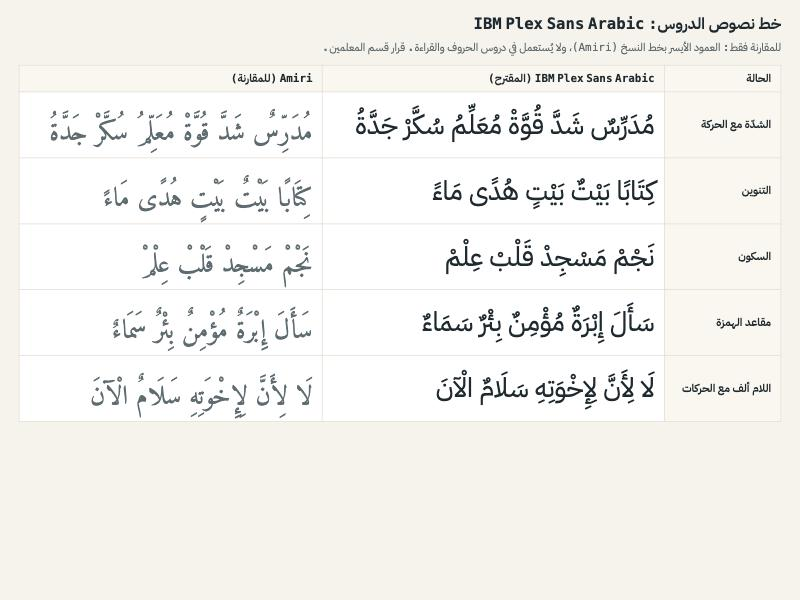

# PD-29 P0-5: the text font of the letter and reading lessons (a Teachers department decision)

The lessons engine used to bundle no font for its text, so every Arabic letter and reading lesson was drawn in the device's system font. That is the same fallback that mis-drew the name of Allah in the Quran games.

The engine now bundles **IBM Plex Sans Arabic** (SIL Open Font License 1.1) for the interface and the letter and reading lessons. These are the same files Admin Web ships (the Arabic subset, weights 400 and 600). They are pinned by path and SHA-256 in `scripts/qa/check-lessons-supply-chain.py`, and nothing was downloaded. Quran text stays in Amiri Quran (`--quran-font`, PD-49 #313) and never uses this font.

## The hardest cases, as drawn

Each row is drawn at reading size, in IBM Plex Sans Arabic (the proposal, middle column) beside Amiri (left column, for comparison only):
- shadda with a vowel: مُدَرِّسٌ شَدَّ قُوَّةْ مُعَلِّمُ سُكَّرْ جَدَّةُ;
- tanween: كِتَابًا بَيْتٌ بَيْتٍ هُدًى مَاءً;
- sukun: نَجْمْ مَسْجِدْ قَلْبْ عِلْمْ;
- the hamza seats: سَأَلَ إِبْرَةٌ مُؤْمِنٌ بِئْرٌ سَمَاءٌ;
- lam-alef with harakat: لَا لِأَنَّ لِإِخْوَتِهِ سَلَامٌ الْآنَ.

Plex draws every mark on its letter. A vowel stacks clearly above or below a shadda, and the lam-alef ligature keeps its marks.

## The decision for the Teachers department

**Is a sans face right for children learning to read, or should the reading text use a naskh face?**

- **Plex (sans), now bundled.** Clean, even letters and very clear marks. It matches the app's interface. Most early-reader books, however, use a naskh face.
- **A naskh face for reading text.** It is closer to the books children read and to the Quran's letterforms. It would need a vendored naskh text font: Amiri (not Amiri Quran) or Noto Naskh Arabic, both OFL. That means a download, and the owner's OK, like the Quran font.

Until the Teachers department decides, the lessons use Plex, which is never a system fallback.
